# Figuras del informe

Todas se generan con `uv run python scripts/26_report_figures.py` → `reports/figures/*.png`
(identidad visual UC, listas para el informe/presentación).

- **Curvas de entrenamiento:** los valores por época se registran en `reports/training_logs/*.csv`
  (los scripts 07/09/12 los guardan; para los modelos ya entrenados se usan las épocas clave
  documentadas en [MODULO_AUDIO.md](MODULO_AUDIO.md) y [MODULO_IMAGEN.md](MODULO_IMAGEN.md)).
- Para regenerar todo con datos frescos: reentrenar (07/09/12) → correr el script 26.

---

## Módulo 1 — Identificación multimodal

### Curvas de entrenamiento

**Fig. 1 — Curva de entrenamiento del CNN de audio (EfficientNet-B0 regularizado).**
Val accuracy/F1 suben hasta ~0.81 y hacen plateau; el mejor checkpoint es la época 67. La
`train loss` se mantiene ~1.2-1.4 (mixup + label smoothing evitan el sobreajuste).
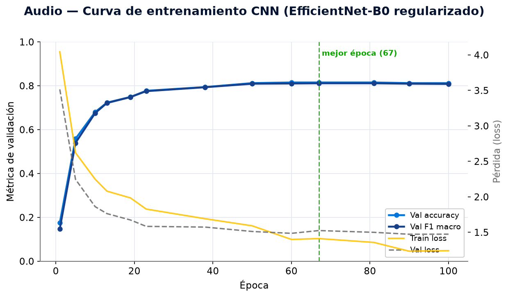

**Fig. 2 — Curva de entrenamiento del AST (transformer preentrenado).**
Convergencia rápida (modelo preentrenado): mejor validación en la época 11, luego plateau.
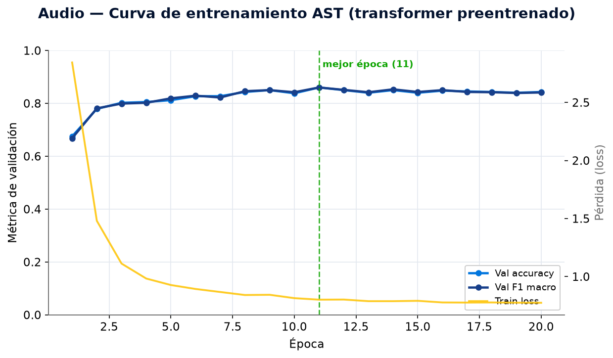

**Fig. 3 — Curva de entrenamiento del clasificador de imagen (EfficientNet-B3).**
Plateau de validación ~0.85 desde la época ~36; mejor checkpoint en la época 38.
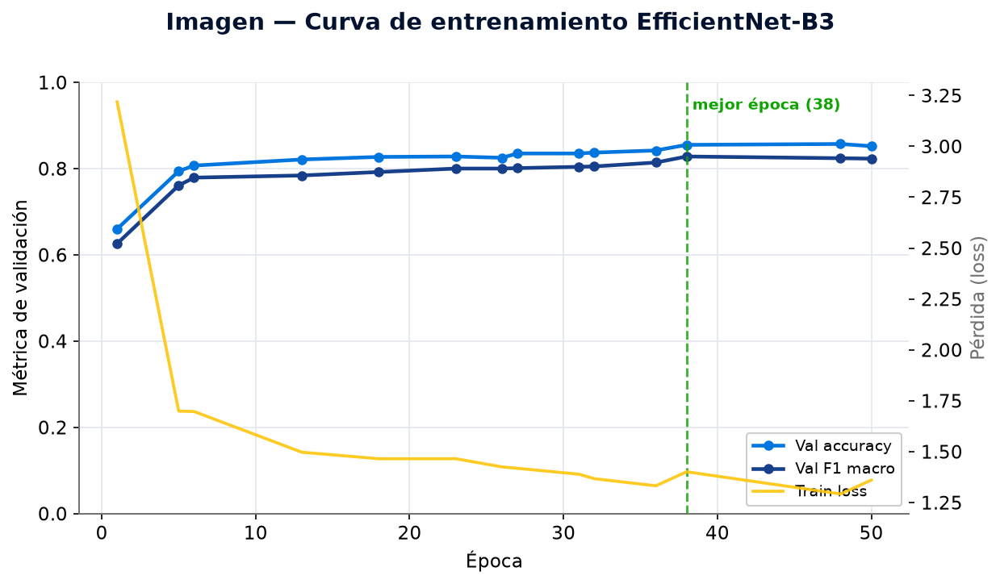

### Comparaciones

**Fig. 4 — Audio: CNN vs. AST y efecto de la agregación por grabación.**
Agregar la probabilidad sobre las ventanas de cada grabación (métrica operacional) sube
~4-5 puntos sobre la ventana individual; ambos modelos superan la meta de 0.85.
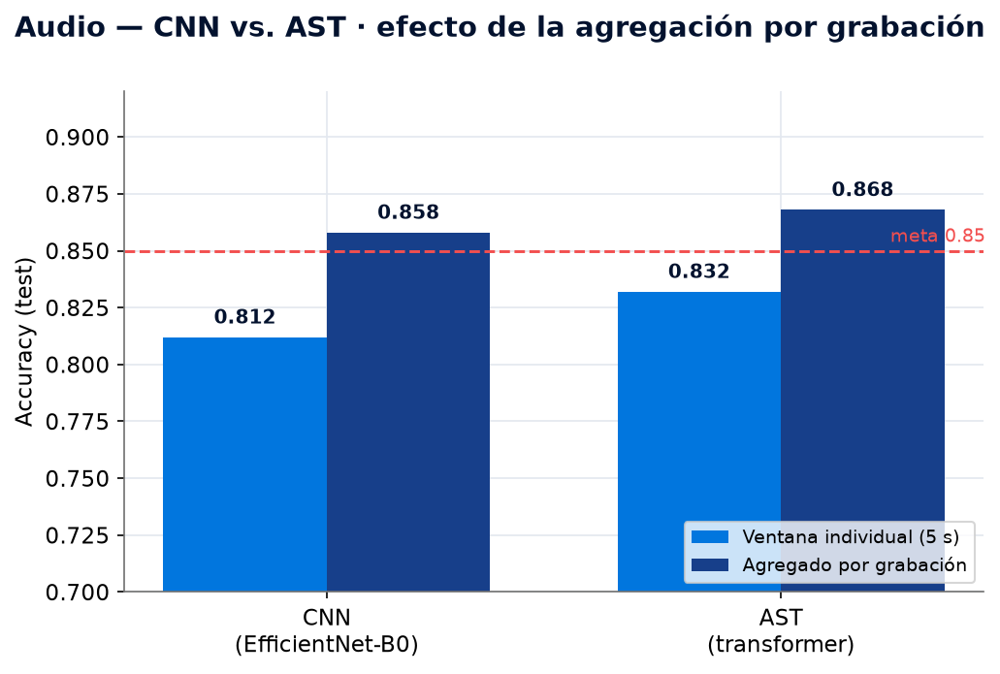

**Fig. 5 — La fusión multimodal supera a cada modalidad.**
Fusión 0.950 > audio 0.867 > imagen 0.825: los errores acústicos y visuales son
complementarios (hipótesis central del Módulo 1).
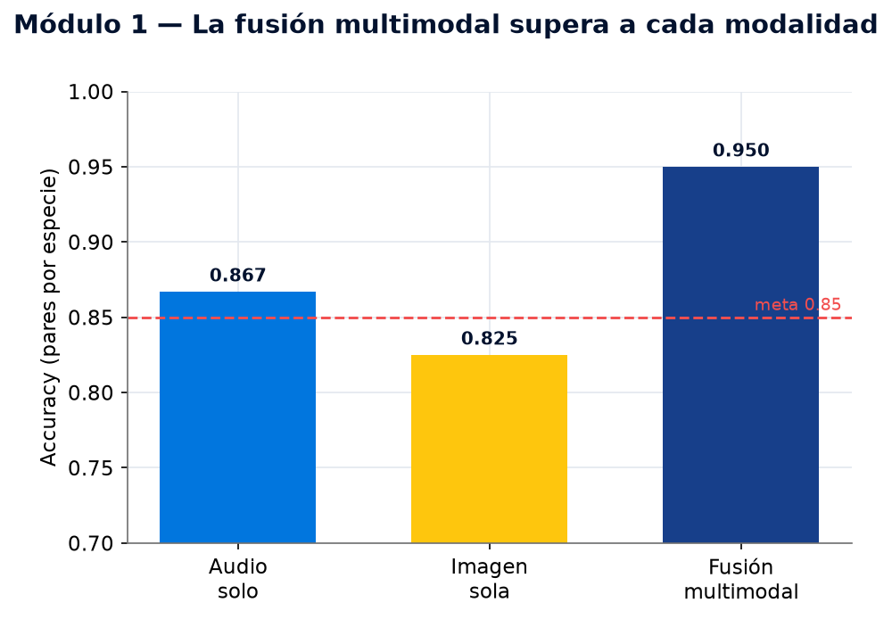

**Fig. 6 — Estrategias de fusión (mismas condiciones).**
Late ≈ early (~0.93) > intermediate (0.906): combinar de la forma más simple es lo óptimo.
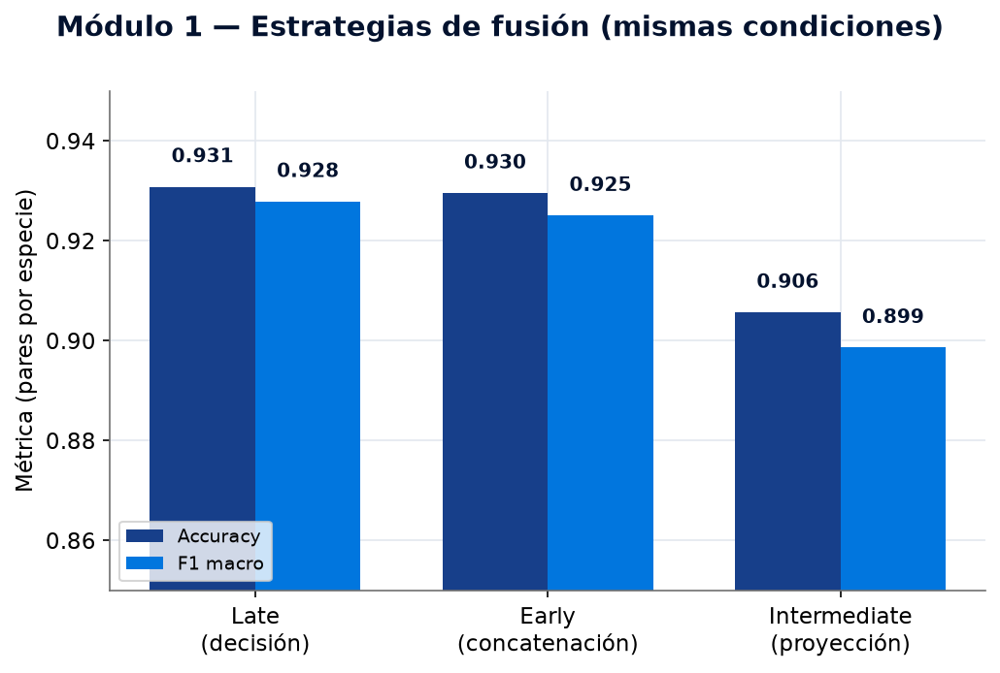

### Datos y desempeño por especie

**Fig. 7 — Grabaciones por especie (audio, Xeno-canto).**
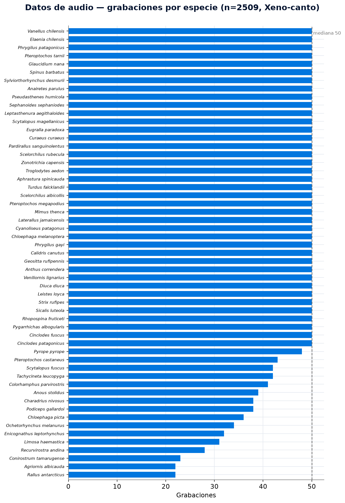

**Fig. 8 — Fotos por especie (imagen, iNaturalist Research-grade).**
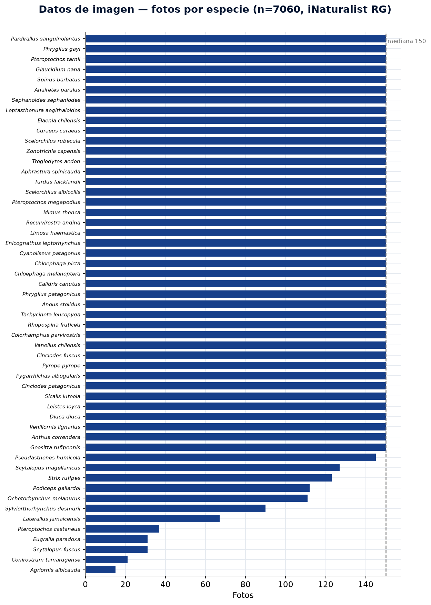

**Fig. 9 — F1 por especie (CNN de audio).** Verde/azul ≥0.8, amarillo 0.6-0.8, rojo <0.6.
Los peores casos son congéneres acústicamente similares y especies con test minúsculo.
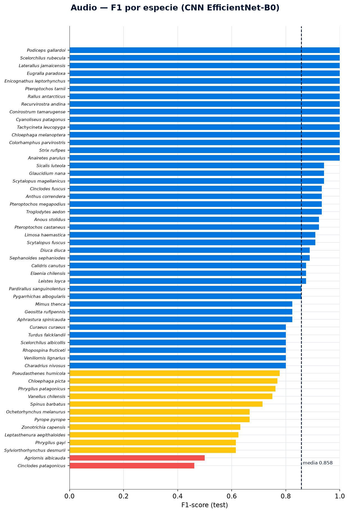

**Fig. 10 — F1 por especie (clasificador de imagen).**
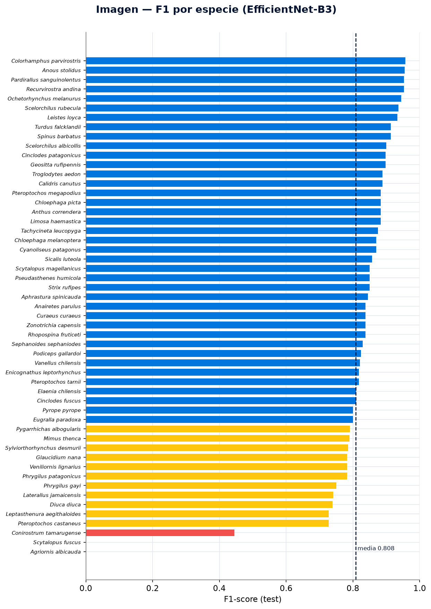

---

## Módulo 2 — Distribución espaciotemporal (SDM)

**Fig. 11 — Avistamientos GBIF (eBird + iNaturalist).**
Distribución temporal (concentrada en años recientes) y estacionalidad (verano austral,
enero-febrero, por mayor esfuerzo de observación).
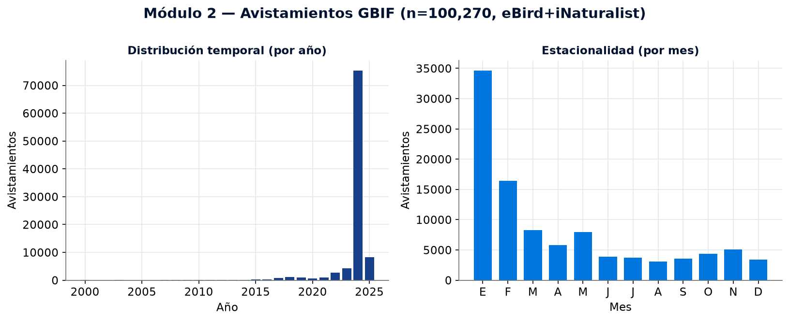

**Fig. 12 — Comparación de modelos SDM.**
Los ensambles de árboles (RF 0.884, GBM 0.883) superan a MaxEnt (0.863); la red neuronal
conjunta no lo supera.
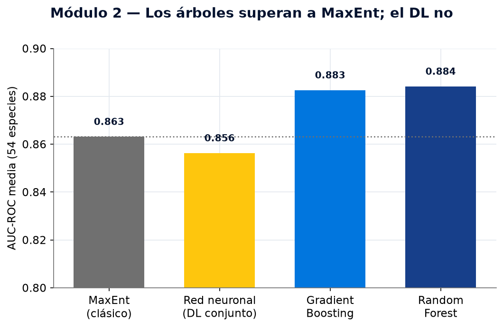

**Fig. 13 — ¿Ayudan las imágenes satelitales? No.**
Ni el embedding satelital ni el parche de cobertura de suelo mejoran sobre la base; el DL
con imagen sobreajusta y el embedding baja incluso a los árboles.
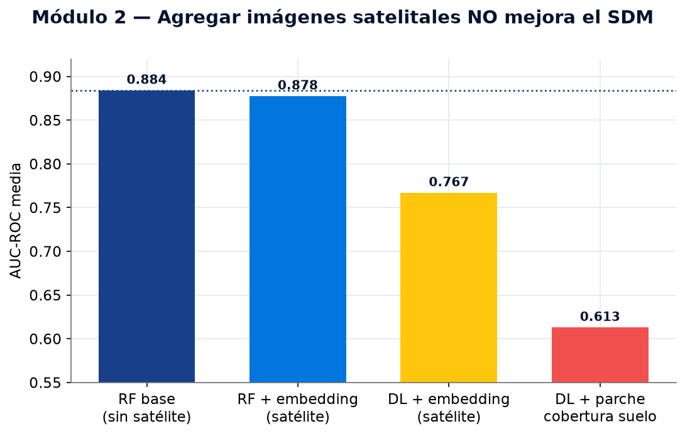

**Fig. 14 — Pareo temporal del satélite (año de la observación).**
Parear la imagen al año del avistamiento ayuda marginalmente (0.880 > 0.877 del compuesto
fijo) pero no supera a la base sin satélite (0.881): el desajuste temporal era menor, la
causa es la redundancia.
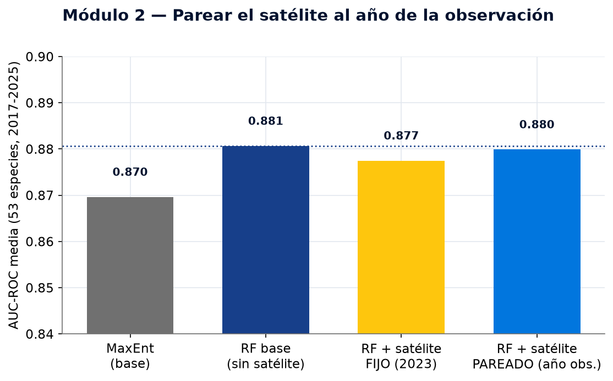

**Fig. 15 — AUC por especie: Random Forest vs. MaxEnt.**
Random Forest (azul) iguala o supera a MaxEnt (gris) en la mayoría de las especies.
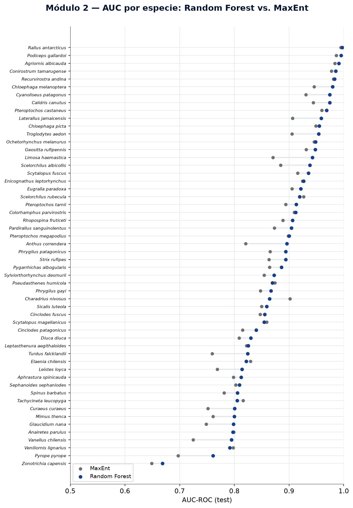
